<!-- SPDX-FileCopyrightText: Copyright (c) 2026 NVIDIA CORPORATION & AFFILIATES. All rights reserved. -->
<!-- SPDX-License-Identifier: Apache-2.0 -->

# NemoClaw Ecosystem

NemoClaw combines deployment management, OpenShell sandbox controls, and NeMo Fabric agent execution.
You use NemoClaw to configure and operate the deployment, then send requests to the running agent through Fabric.

## Understand Each Component

| Component | Responsibility |
|---|---|
| NemoClaw | Turn desired-state YAML into deployment resources, connect inference, and retain deployment state for recovery. |
| [NVIDIA OpenShell](https://docs.nvidia.com/openshell/about/overview) | Manage sandboxes, enforce filesystem, process, and network policy, and deliver provider credentials at authorized destinations. |
| [NVIDIA NeMo Fabric](https://docs.nvidia.com/nemo/fabric/) | Discover agent adapters, validate and map their native configuration, and start, invoke, and stop agent runtimes. |
| Agent harness, such as OpenClaw, Hermes, or Pi | Handle user requests, call models and tools, and manage its native sessions and behavior. |
| Inference service | Serve model requests through a hosted endpoint or a managed service such as Ollama or vLLM. |

NemoClaw's CLI and Rust SDK use [OpenTofu](provider.md) to order resource operations and record resource state.
OpenShell enforces the sandbox's access controls while Fabric runs the selected harness inside it.
The [accepted scope](design/scope.md#upstream-boundaries) defines these ownership boundaries.

```mermaid
flowchart TD
    NemoClaw["NemoClaw: deployment management"] --> Gateway["OpenShell gateway"]
    Gateway --> Fabric
    subgraph Sandbox["OpenShell sandbox: enforced access controls"]
        Fabric["NeMo Fabric: agent execution"] --> Agent["Selected agent harness"]
    end
    Agent -->|Inference requests| Gateway
    Gateway --> Model["Hosted or managed inference"]
```

## Follow a Deployment

For an OpenClaw deployment, the components take these roles:

1. You choose the gateway, agent image, inference provider, model, and sandbox policy in deployment YAML.
   [Guided onboarding](reference/cli.md#commands) can help author that file; it does not deploy resources.
2. NemoClaw plans the resource changes, then applies them through OpenTofu.
   OpenShell creates the sandbox and applies the deployment's access controls.
3. Fabric validates the OpenClaw configuration and starts its runtime inside the sandbox.
   OpenClaw handles the conversation and tool use, with inference connections configured through OpenShell.
4. You [send a request through OpenShell](agents.md#run-one-headless-openclaw-request) to the running agent.
   Verify an agent reply separately: applying deployment configuration does not send an agent request.

Use [desired-state operations](usage.md) for deployment changes and recovery, and [agent runtimes](agents.md) for requests and native configuration.

## Choose Where to Start

| Your task | Starting point |
|---|---|
| Deploy and manage agents with gateway, inference, policy, and state in one configuration | NemoClaw's [prerequisites](prerequisites.md) and [first deployment](get-started.md). |
| Build an application or evaluation that invokes different harnesses through a common API | [Fabric documentation](https://docs.nvidia.com/nemo/fabric/); your application owns its deployment workflow. |
| Run a workload in a sandbox and configure its image, policy, and agent integration yourself | [OpenShell documentation](https://docs.nvidia.com/openshell/). |

Fabric can be used independently of NemoClaw, and OpenShell can sandbox workloads that do not use Fabric.
In NemoClaw, the agent images include Fabric and the selected harness; follow [the image build guide](build.md#build-agent-images) for this deployment path.

## Match the Components to Your Deployment

Use the bundle, image, schema, and documentation from the same NemoClaw revision.
An adapter available in Fabric does not establish compatibility with your NemoClaw image, model, or platform.
Check [Fabric harnesses](reference/fabric-harnesses.md), [compatibility across releases](compatibility.md), and [current limits](limits.md) before choosing a configuration.
